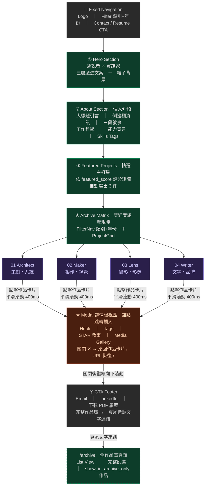
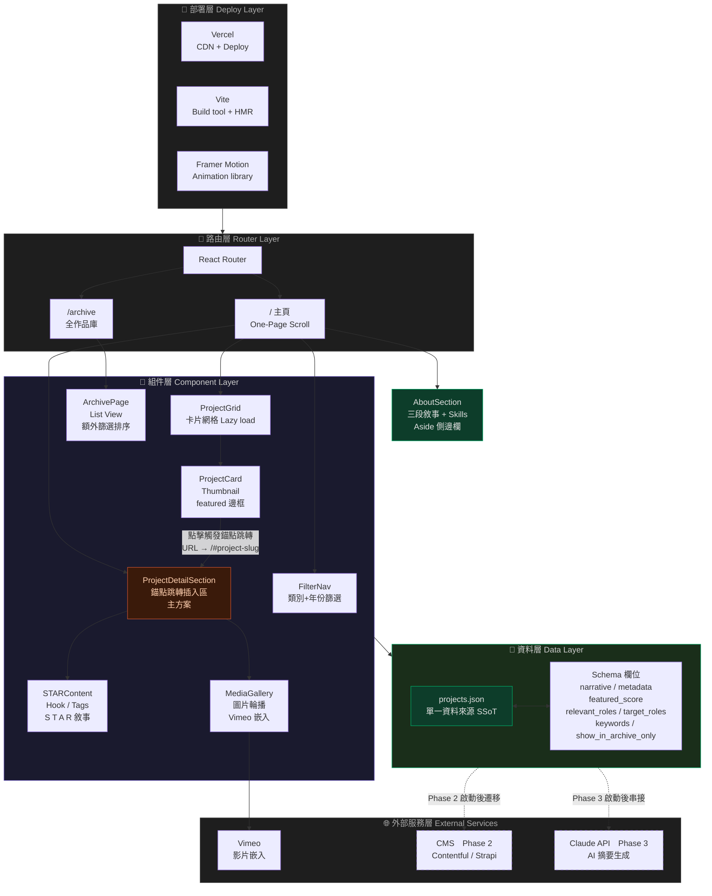

# 🎓 四年縮影：個人線上畢業展覽
## 企劃書大綱 v2.2
### Exhibition Proposal Blueprint

---

## I. 專案核心與目標定位 Project Overview & Core Philosophy

### 1.1 專案目的與願景 Goal and Vision

**專案目的**
將四年學習歷程提煉為線上策展，精準向甲方或潛在雇主展現個人綜合戰力，作為取得面試或商業合作的最佳利器。

**願景**
從「畢業展覽」出發，發展為「個人化的數位策展系統」。

**核心定位**
具備高度企劃腦與強大執行手的跨界人才。

**定位綜述**
展現「策略、創意、執行力」與「處理複雜資訊並說好故事」的綜合敘事能力。

**目標受眾 Target Audience**
招募主管、面試官、潛在合作客戶。閱讀耐心極低，需在 30 秒內透過強烈視覺與精準關鍵字留住目光。

---

### 1.2 登陸主視覺與核心定位 Hero Section & Brand Identity

**定名**
述說者 ✕ 實踐家 / The Storyteller ✕ The Executor

**視覺文案結構（三層遞進）**

```
【大字主標題】
述說者 ✕ 實踐家

【動態副標題 — Typing Effect】
說故事的腦。做實事的手。

【痛點錨定語 — 換行獨立呈現】
讓複雜的事情，變得清晰可執行。
```

*EN 對應：The Storyteller ✕ The Executor / A Mind for Stories. Hands for Action. / Turning complexity into clarity — and clarity into action.*

**視覺設計規範**
漆黑背景中，大標題以純白粗體強勢佔據畫面。中間的「✕」與副標題的關鍵字以螢光綠（`#00FF88`）打亮。痛點錨定語獨立換行，字級略小，以柔和白灰（`#E0E0E0`）呈現，避免與主標題搶奪視覺焦點。

---

## II. 資訊組織架構與介面設計 Information Architecture & UI/UX Guidelines

### 2.1 頁面結構與導覽 Structure and Navigation

整體採用單頁滾動式（One-Page Scroll）+ Modal 作品詳情展開，確保瀏覽動線流暢不中斷。放棄傳統深層巢狀頁面架構。

**版面配置原則**
強調留白美學（Negative Space），作品總覽區以俐落的幾何網格（Grid）排列，避免四年累積的資訊顯得雜亂。

---

### 2.2 頁面核心區塊 Core Sections

**① 破題登陸 Hero Section**
展現三層遞進文案，建立無可取代的第一印象。

**② 個人介紹 About Section**
緊接 Hero 之後，提供人物縱深。訪客在視覺衝擊後立刻獲得「這個人是誰」的答案，強化信任感，為進入作品區做情感鋪墊。詳細內容規範見第 II.6 節。

**③ 精選主打星 Featured Projects**
強制曝光 3 個依據「特選評分矩陣」（見 3.3 節）評選出的頂規專案。

**④ 雙維度總覽矩陣 The Archive Matrix**
運用互動式過濾器（Filter），依據四大核心能力類別或年份進行作品篩選。

| 類別代碼 | 名稱 | 核心角色定義 | 涵蓋範疇 |
|----------|------|-------------|---------|
| 01 | **Architect｜策劃與系統設計** | 定義問題、設計框架、規劃全局的人 | 活動企劃、專案管理、資訊架構、流程設計 |
| 02 | **Maker｜製作與視覺實現** | 把概念變成實際產出物的人 | 網頁設計、視覺設計、原型製作、平面輸出 |
| 03 | **Lens｜攝影與影像敘事** | 用鏡頭捕捉並詮釋現實的人 | 個人寫真、劇照、演出紀錄、影像後製 |
| 04 | **Writer｜文字與品牌敘事** | 賦予事物意義與語言的人 | 世界觀設計、小說撰寫、文案企劃、故事型品牌內容 |

> **多標籤作品的主分類歸屬原則：** 主分類依據「你在該專案中投入最多判斷力的角色」，而非輸出物的形式。次要標籤可複選，但主分類唯一。

**⑤ Modal 作品詳情區**
點擊作品卡片後，於 Archive Matrix 與 CTA Footer 之間插入展開的詳情區塊。詳細互動行為見第 II.4 節。

**⑥ 行動呼籲 Call to Action**
常駐於頁面底部的聯絡資訊（Email / LinkedIn）與「下載完整 PDF 履歷」按鈕。作品詳情展開時，CTA 被往下推，瀏覽者仍可直接滾動至 CTA 操作。

---

### 2.3 介面與視覺設計規範 UI/UX Guidelines

**設計原則**
在極簡科技風與長篇閱讀的舒適度之間取得完美平衡。

**色彩計畫 Color Palette**

| 用途 | 色碼 | 說明 |
|------|------|------|
| 主背景 | `#050505` | 純黑背景 |
| 主文字 | `#FFFFFF` | 純白粗體 |
| 強調色 | `#00FF88` | 螢光綠亮點，用於「✕」符號與關鍵字打亮 |
| 彈窗背景 | `#121212` | 深灰，降低強光暈眩感 |
| 彈窗內文 | `#E0E0E0` | 柔和白灰，確保長篇閱讀舒適度 |

---

### 2.4 作品詳情互動設計 Modal Interaction Design

*(新增章節)*

#### 主方案：錨點跳轉式 Anchor Jump

**互動行為**
點擊任一作品卡片後，頁面以平滑滾動（400–500ms）跳至 Archive Matrix 與 CTA Footer 之間的「詳情檢視區」。該區塊內容動態替換為所點選作品的完整 Modal 詳情。同一時間僅展示一件作品詳情。

**URL 行為**
跳轉同時更新 URL 為 `/#project-{slug}`（例：`/#project-p001`），支援直接連結分享與瀏覽器書籤。

**收合行為**
詳情區頂部設置明顯的「關閉 ✕」按鈕，收合後頁面滾回對應的作品卡片位置，URL 恢復為 `/`。

**頁面結構示意**
```
[Hero Section]
[Featured Projects]
[Archive Matrix + FilterNav]
  ↓ 點擊作品卡片，平滑滾動至此
[★ 詳情檢視區（動態插入）]
  — Hook、Tags、STAR 敘事、Media Gallery —
  — 關閉按鈕 ✕ —
[CTA Footer]  ← 瀏覽者仍可直接滾動到達
```

**動畫規格**
- 詳情區展開：`height: 0 → auto`，搭配 Framer Motion `spring, stiffness: 80`
- 內容淡入：`opacity: 0 → 1`，delay 100ms（等展開動畫完成後）
- 平滑滾動：`behavior: 'smooth'`，duration 400ms

**視覺提示設計**
詳情區頂部以螢光綠左側邊框（`border-left: 3px solid #00FF88`）標示「目前查看作品」，並在對應的作品卡片上保留高亮狀態，讓使用者清楚知道詳情對應哪件作品。

**RWD 行為**
- Desktop：詳情區為全寬兩欄佈局（左：STAR 敘事，右：Media Gallery）
- Mobile：單欄堆疊，Media Gallery 置於 STAR 敘事下方

---

#### 備案：側邊滑入式 Side Drawer

適用情境：若未來評估後發現錨點跳轉在特定裝置或使用情境下體驗不佳，可切換為此方案。

**互動行為**
點擊作品卡片後，詳情從螢幕下側以 spring 動畫滑入畫面正中央，佔據畫面約 45% 寬度。點擊背景或按 Escape 關閉，並鎖定頁面捲動。放大的作品卡片資訊畫面大小比例如螢幕比例，背景的主頁內容模糊變暗。

**主要差異**
頁面完全不位移，無推擠問題。代價是在手機端（< 768px）會強制切換為全螢幕覆蓋，CTA 暫時不可見。

**切換條件**
Phase 1 上線後，若使用者測試回饋顯示錨點跳轉的滾動距離造成明顯困擾，啟動備案評估。

---

### 2.6 個人介紹區塊設計規範 About Section Design

*(新增章節)*

#### 2.6.1 定位與敘事邏輯

About 區塊緊接 Hero Section 之後，作用是將「品牌氣場」轉化為「人的縱深」。訪客在 Hero 被吸引後，立刻在此獲得三個問題的答案：你是誰、你怎麼工作、為什麼要選擇你。

敘事採三段遞進結構，對應 Hero 的三層文案邏輯：

| 段落 | 副標題方向 | 敘事目的 |
|------|-----------|---------|
| 第一段 | 開場白：打破單一職稱的框架 | 建立「無法被輕易歸類」的記憶點 |
| 第二段 | 做事的人，也說故事的人 | 用劇場思維說明工作哲學，建立信任 |
| 第三段 | 策略、創意，以及把事情做完的能力 | 明確呼籲行動，連結到 CTA |

#### 2.6.2 頁面版面結構

**桌面版（Desktop）**
兩欄佈局：左側為側邊資訊欄（About Aside），右側為主體文字區（About Body）。比例約 1：2。

**手機版（Mobile）**
單欄堆疊，側邊資訊欄拆分為兩欄網格排列，個人形象照置於最下方。

#### 2.6.3 側邊欄資訊規範 About Aside

以下欄位依序排列，Key 以等寬字體小字呈現，Value 以較大字體白灰色呈現：

| 欄位 Key | 內容說明 | 填入狀態 |
|---------|---------|---------|
| Based in | 所在城市 | `[ 待填入：城市名稱 ]` |
| Working since | 開始接案或工作的年份至今 | `[ 待填入：年份 ] — Present` |
| Languages | 語言能力 | `[ 待填入：語言與程度 ]` |
| Currently | 目前接案狀態與時間 | `[ 待填入：狀態 ]`，以螢光綠圓點標示開放中 |

**個人形象照（About Portrait）**
- 比例：桌面版 3:4（直向），手機版 1:1
- 目前為格紋佔位圖（Placeholder），待正式上架時替換為個人形象照
- 照片風格建議：非正式、帶有情緒感，與 Hero 區的「編輯感」形象互補
- 標注文字：`[ 待填入：個人形象照 ]`，以等寬字體小字置於左下角

#### 2.6.4 主體文字規範 About Body

**大標題 About Big Title（頁首引言）**

置於 About 區塊頂部，橫跨全寬，字級大、行距緊，作為視覺錨點。

> `[ 待填入：個人引言，建議 20–35 字，帶有個人語氣的破題句 ]`
>
> 範例參考（來自 HTML 檔）：「簡介欄位永遠不夠用，所以我做了這個網站。」

---

**第一段：開場白**

無副標題，直接進入，字數建議 60–100 字。目的是打破「一個職稱說清楚」的預期，製造記憶點。

> `[ 待填入：開場白段落 ]`
>
> 撰寫方向：描述自己的工作狀態是「難以被單一定義的」，列出幾個你曾扮演的角色，以輕鬆語氣收尾。

---

**第二段：工作哲學**

副標題：`[ 待填入：副標題，建議 10–20 字，呼應「說故事」或「幕後工作觀」]`

字數建議 80–120 字。以具體的工作場景或比喻說明你的工作哲學，讓雇主或甲方理解你如何思考問題。

> `[ 待填入：工作哲學段落 ]`
>
> 撰寫方向：從劇場、攝影或某個具體經驗出發，說明你如何面對複雜的執行現場，以及你從中學到什麼工作觀。

---

**第三段：能力宣言與 CTA 鋪墊**

副標題：`[ 待填入：副標題，建議 10–20 字，呼應「把事情做完」或「跨領域優勢」]`

字數建議 80–120 字。整合前兩段，明確說明你的跨領域優勢，以行動呼籲句結尾，自然銜接至 CTA。

> `[ 待填入：能力宣言段落 ]`
>
> 撰寫方向：說明跨領域不是弱點而是優勢的具體原因，最後一句以「你需要⋯⋯我在這裡」或類似結構收尾，強度要夠。

---

**技能標籤 Skills**

置於第三段文字之後，以 Pill 樣式排列。hover 時邊框與文字轉為螢光綠。

> `[ 待填入：技能標籤列表 ]`
>
> 建議數量：6–10 個，以中文為主，對應四大類別（Architect / Maker / Lens / Writer）各自的核心技能。

#### 2.6.5 視覺設計規範

| 元素 | 規格 |
|------|------|
| 大標題字體 | Noto Sans TC，Black weight，`clamp(36px, 5.6vw, 84px)` |
| 副標題字體 | Noto Sans TC，Black weight，`clamp(28px, 4vw, 56px)` |
| 內文字體 | Noto Sans TC，Light weight，17px，行距 1.95 |
| 側邊欄 Key | JetBrains Mono，10px，letter-spacing .28em，`#8a8a8a` |
| 側邊欄 Value | Noto Sans TC，14px，`#cfcfcf` |
| Skill Pill | JetBrains Mono，11px，border `#262626`，hover 轉 `#00FF88` |
| 形象照佔位 | 格紋斜線圖案，`#0e0e0e` / `#161616` 交替 |

#### 2.6.6 內容撰寫優先順序建議

1. 先完成大標題引言（最短，影響最大）
2. 填入側邊欄資訊（純資料，快速完成）
3. 撰寫第三段能力宣言（最重要，直接影響 CTA 轉換）
4. 補完第一段開場白與第二段工作哲學
5. 最後確認技能標籤是否與四大類別對應一致

---

### 2.5 網站架構圖 Site Architecture Diagrams

#### 完成的專案結構
src/
├── data/projects.json          ← SSoT，5 個佔位作品
├── hooks/useReveal.js          ← Intersection Observer scroll reveal
├── pages/
│   ├── HomePage.jsx            ← 主頁，管理 activeProject 狀態
│   └── ArchivePage.jsx         ← /archive，含排序 + 完整詳情區
├── components/
│   ├── Nav.jsx                 ← 固定導覽列 + 手機 hamburger
│   ├── Hero.jsx                ← 述說者 ✕ 實踐家 + typing effect
│   ├── About.jsx               ← 策略×創意×執行力 + 三段敘事佔位
│   ├── FeaturedProjects.jsx    ← 自動取前 3 高分作品
│   ├── ArchiveMatrix.jsx       ← FilterNav + ProjectGrid
│   ├── FilterNav.jsx           ← 類別/年份篩選器
│   ├── ProjectCard.jsx         ← 卡片（Framer Motion hover）
│   ├── ProjectDetailSection.jsx← 錨點跳轉展開區（spring 動畫）
│   ├── STARContent.jsx         ← Hook + S/T/A/R 敘事
│   ├── MediaGallery.jsx        ← 圖片輪播 + Vimeo 嵌入
│   └── CTAFooter.jsx           ← 聯絡 + PDF 履歷 + site footer


#### 圖一：資訊架構視角 IA Diagram

以使用者滾動動線為主軸，呈現頁面各區塊的內容組成與層級關係。核心重點：Modal 詳情區以錨點跳轉方式插入於 Archive Matrix 與 CTA Footer 之間，非覆蓋式彈窗；頁面其他區塊完整保留，瀏覽者可直接滾動操作 CTA。`/archive` 為獨立頁面，入口為頁尾低調文字連結。



---

#### 圖二：技術架構視角 Tech Architecture Diagram

分五層呈現技術組件與資料流向。`projects.json` 為單一資料來源（SSoT），所有組件從它讀取。虛線框代表 Phase 2／3 的未來擴充，Phase 1 開發時需預留對應欄位（`relevant_roles`、`target_roles`、`keywords`）。



---

## III. 單一作品敘事模組 Content Narrative Module & Framework

### 3.1 敘事模組原則 Module Principles

點擊作品卡片後展開的專案詳情區（Modal），需具備高度結構化的易讀性（Scannability）。每一項作品皆遵循標準化敘事模組，確保資訊傳遞高效一致。

---

### 3.2 敘事框架構成 Narrative Framework Components

**① 一句話亮點 The Hook**
該專案最核心痛點的解決方案或最大成就。用一句話抓住閱讀者的注意力。

**② 專案標籤 Tags**
標示年份、擔任角色、所屬主分類與次要標籤。以 Pill 樣式呈現。

**③ STAR 敘事區塊**
以「情境、任務、行動、結果」拆解複雜專案，精準展示思考力與執行力。

| 欄位 | 問題 | 字數上限 |
|------|------|---------|
| S — 情境 Situation | 為什麼要做？背景脈絡是什麼？| 合計 |
| T — 任務 Task | 當時需要達成的核心目標是什麼？| 100 字 |
| A — 行動 Action | 你具體採取了哪些設計或企劃行動？（以第一人稱主動句開頭）| 150 字 |
| R — 結果 Result | 量化數據、具名評價、或後續影響。| 80 字 |

**④ 多媒體展演 Media Gallery**
高畫質照片輪播、動態 Prototype 或影像紀錄。整合高畫質圖像與動態影像，讓作品自己說故事。

---

### 3.3 精選主打星評選標準 Featured Projects Selection Matrix

每件作品以三個維度各給 1–3 分，總分最高的前三件自動成為 Featured Projects。

**維度 A：商業可溝通性（1–3 分）**
- 1 分：個人習作或課堂作業，無外部受眾
- 2 分：有真實受眾或客戶，但成果難以量化
- 3 分：有具名甲方、真實用戶，或可量化的成果數據

**維度 B：能力跨度（1–3 分）**
- 1 分：單一類別能力展示
- 2 分：跨越兩個類別
- 3 分：跨越三個以上類別，或同時展現策略與執行兩個層次

**維度 C：敘事完整度（1–3 分）**
- 1 分：Hook 或 Result 任一缺失
- 2 分：STAR 四欄皆有內容，但 Result 為純質性描述
- 3 分：STAR 四欄完整，且 Result 包含量化數據或具名評價

> 總分 7–9 分者為 Featured 候選，由最高分前三名自動入選。評分結果記錄於 `projects.json` 的 `metadata.featured_score` 欄位，供 Claude Code 在渲染時自動判斷。

---

## IV. 內容策略規範 Content Strategy Guidelines

*（新增章節）*

### 4.1 作品數量規範

- 每個類別上限 **5 件**，全站主展示區上限 **20 件**
- Featured Projects 固定 3 件，不計入類別上限
- 原則：**寧可 15 件件件有力，也不要 30 件稀釋注意力**

---

### 4.2 各欄位品質標準

**Hook（上限 30 字）**
必須包含「動詞＋受益對象＋結果」的結構。

- ❌ 錯誤示範：「這是一個活動企劃專案。」
- ✅ 正確示範：「為 300 人規模的年度展演設計了從零到落地的完整製作流程。」

**Action（上限 150 字）**
以「我主導了⋯⋯」「我設計了⋯⋯」「我協調了⋯⋯」等第一人稱主動句開頭，強調個人判斷與決策，而非團隊行為的集合描述。

**Result（上限 80 字）**
必須包含以下至少一項：
1. 量化數字
2. 具名評價（甲方、老師、合作者）
3. 後續影響（這個成果導致了什麼）

> 若三者都無法提供，這件作品暫不建議上架。

---

### 4.3 媒體素材品質門檻

| 素材類型 | 最低規格 | 備注 |
|---------|---------|------|
| 縮圖 Thumbnail | 800 × 600 px | 主體清晰，無明顯雜訊 |
| Modal 內圖片 | 1200 px 寬以上 | 設計稿截圖需去背或加統一底色 |
| 影片 | Vimeo 嵌入 | 避免直接上傳影響載入速度 |

> 素材不足時的原則：**寧可只放一張好圖，也不要放五張品質參差的圖。**

---

### 4.4 作品上架審查清單 Entry Checklist

每件作品上架前需通過以下自我檢核：

- [ ] Hook 是否符合「動詞＋受益對象＋結果」結構？
- [ ] Hook 是否在 30 字以內？
- [ ] STAR 四欄是否皆有填寫？
- [ ] Result 是否包含量化數字、具名評價或後續影響至少其一？
- [ ] 縮圖是否達到 800 × 600 px 最低規格？
- [ ] Modal 內圖片是否達到 1200 px 最低規格？
- [ ] 主分類是否唯一確認？
- [ ] `featured_score` 三維度是否已評分？

---

## V. 發展階段藍圖與技術規格 Development Roadmap & Technical Standards

### 5.1 技術規格與品質控管 Technical Standards

**效能掛帥 Performance**
針對大量的 Lens 與 Maker 類圖檔，全面導入圖片延遲載入（Lazy Loading）與縮圖預載技術，確保首屏秒開。

**無縫響應 RWD**
確保在手機、平板、筆電皆能維持極簡美學與完美排版。面試官在手機端依然能順暢體驗這場極簡視覺饗宴。

**高擴展性 Scalability**
採用組件化（Component-based）開發，確保每個階段的新增功能不會破壞原有的視覺一致性。

---

### 5.2 技術規格需求表 Tech Spec

```markdown
# Technical Specification: Personal Portfolio Exhibition Site (Phase 1)

## 1. Goal
Develop a high-performance, visually striking personal portfolio website focused on the 
"Storyteller x Executor" persona. The user experience must be immersive, prioritizing 
visual impact and seamless information flow.

## 2. Tech Stack Requirements
- Framework: React + Vite (for development speed and smooth animation integration)
- Styling: Tailwind CSS or standard CSS with CSS Grid/Flexbox for custom grid layouts
- Interaction: Framer Motion (for smooth Modal animations)
- Optimization: Lazy loading for images, optimized asset compression

## 3. Core Functional Requirements
- Global Filter: Persistent filter UI (Categories: Architect, Maker, Lens, Writer / Time: Year)
- Project Grid: Responsive grid that re-orders automatically based on filter selection
- Modal System (Anchor Jump — primary):
    - Smooth scroll (400–500ms) to detail section between Matrix and CTA on card click
    - URL updates to /#project-{slug} for shareability
    - Detail section: Hook, Tags (pill), STAR blocks, Media Gallery
    - Close button scrolls back to clicked card, URL resets to /
    - Fallback: Side Drawer if scroll UX proves problematic post-launch
- Navigation: Fixed top-nav with "Contact/Resume" CTA button
- Archive Page: Separate /archive route with high-density list view

## 4. UI/UX Style Guide
- Colors: Background #050505, Text #FFFFFF, Highlights #00FF88
- Modal detail area: Background #121212, Body Text #E0E0E0
- Active project card: neon green left border accent #00FF88
- Layout: Generous negative space. Geometric lines and dot patterns as visual dividers.
- Typography: Clean sans-serif (Inter, system-ui), bold weights for titles
- Responsiveness:
    - Desktop: Modal detail = two-column (STAR left, Media right)
    - Mobile: Single-column stack, Media below STAR

## 5. Development Strategy
- Component-based structure: AboutSection, ProjectGrid, FilterNav, ProjectCard,
  ProjectDetailSection, STARContent, MediaGallery, ArchivePage
- Performance: Preload grid thumbnails, lazy-load high-res Modal assets
- Scalability: JSON-based project data for future CMS migration (Contentful / Strapi)
```

---

### 5.3 projects.json 資料結構規範

```json
{
  "projects": [
    {
      "id": "p001",
      "title": "專案名稱",
      "slug": "project-url-friendly-name",
      "year": 2026,
      "category": "Architect",
      "tags": ["活動企劃", "流程設計"],
      "thumbnail": "/images/p001-thumb.jpg",
      "media": [
        { "type": "image", "url": "/images/p001-1.jpg" },
        { "type": "video", "url": "https://vimeo.com/..." }
      ],
      "narrative": {
        "hook": "一句話總結：動詞＋受益對象＋結果。（上限 30 字）",
        "situation": "說明專案發生的脈絡或背景。",
        "task": "明確定義當時需要達成的核心目標。（S+T 合計上限 100 字）",
        "action": "我主導了／設計了／協調了⋯⋯（上限 150 字，第一人稱主動句）",
        "result": "量化數字、具名評價或後續影響。（上限 80 字）"
      },
      "metadata": {
        "is_featured": true,
        "featured_score": {
          "commercial": 3,
          "skill_range": 2,
          "narrative": 3,
          "total": 8
        },
        "tools": ["Figma", "React", "Illustrator"],
        "relevant_roles": ["活動製作", "品牌內容"],
        "target_roles": ["活動統籌", "內容策劃"],
        "keywords": ["活動企劃", "跨部門協調", "流程設計"],
        "show_in_archive_only": false
      }
    }
  ]
}
```

**新增欄位說明**

| 欄位 | 用途 |
|------|------|
| `featured_score` | 記錄三維度評分與總分，供系統自動判斷 Featured 資格 |
| `relevant_roles` | 描述這件作品能對應的工作職能，用於受眾溝通 |
| `target_roles` | 申請職位關鍵字，供 Phase 3 AI 摘要功能使用 |
| `keywords` | 作品核心能力關鍵字，供 Phase 3 履歷生成功能使用 |
| `show_in_archive_only` | `true` 時，作品只出現在 `/archive` 全作品庫，不出現在主頁矩陣 |

---

### 5.4 動畫設計規範 Animation & Interaction Specs

```markdown
# Animation Specs

## Hero Section
- Typing machine effect for three-layer slogan
- Glitch effect on main title hover
- Mouse-tracking particle background

## Global Transition
- Physics-based transition (Framer Motion: type: "spring", stiffness: 100)

## Modal Detail Section (Anchor Jump)
- Expand: height 0 → auto, spring stiffness: 80
- Content fade-in: opacity 0 → 1, delay 100ms after expand
- Smooth scroll to detail: behavior smooth, ~400ms
- Close: reverse expand, scroll back to source card

## Narrative View (STAR Sections)
- Scroll-triggered timeline progression
- Intersection Observer for performance

## Archive Page
- Instant filter response (no animation delay)
- Subtle fade-in for filtered results
```

---

## VI. 全作品庫頁面設計 Archive Page Design

*（新增章節）*

### 6.1 設計定位

全作品庫頁面（`/archive`）是所有作品的完整索引，定位為**個人管理工具兼對外開放的透明展示**。

### 6.2 入口設計

- **不放入主導覽列**，改為放置於頁尾（Footer）以低調的文字連結呈現
- 建議文案：「完整作品庫 →」或「View Full Archive →」
- 此設計邏輯：主頁是精選的「策展視角」，Archive 是完整的「索引視角」，兩者互補而不衝突

### 6.3 頁面功能規格

**視圖類型**
採用密度更高的**清單視圖（List View）**，而非卡片網格，方便快速掃描與管理。每行顯示：縮圖小圖、標題、年份、主分類、Tags、featured_score 總分。

**篩選與排序功能**
除主頁的類別篩選外，Archive 額外提供：
- 依年份排序（新→舊 / 舊→新）
- 顯示所有標籤（含次要標籤）
- 依 `featured_score` 排序
- 顯示 `show_in_archive_only` 的作品（主頁不顯示者）

**作品點擊行為**
點擊後同樣以錨點跳轉方式展開詳情區，與主頁體驗一致。

### 6.4 `show_in_archive_only` 使用情境

| 情境 | 建議設定 |
|------|---------|
| 作品完整但不適合作為主要展示 | `true` |
| 課堂習作、實驗性作品 | `true` |
| 品質達標且具商業說服力的作品 | `false`（出現在主頁） |
| 尚在整理中的作品 | 建議暫不上架，完成後再設定 |

---

## VII. 發展階段藍圖 Phased Development Roadmap

### 第一階段：沈浸式視覺展演 The Exhibition Phase

**目標**
於畢業展期間，以高度視覺化的單頁滾動（One-Page Scroll）提供甲方與雇主沈浸式瀏覽體驗。

**關鍵功能**
- 互動式總覽矩陣（依四大類別與年份篩選）
- 錨點跳轉式 Modal 詳情區（Archive Matrix 與 CTA 之間插入展開）
- 極簡視覺識別系統（深黑基調與螢光綠點綴）
- 全作品庫頁面 `/archive`（List View，頁尾低調入口）

**Phase 1 資料預留**
為支援後續階段，Phase 1 的 `projects.json` 即需預留以下欄位（可暫為空值）：
`relevant_roles`、`target_roles`、`keywords`、`featured_score`、`show_in_archive_only`

---

### 第二階段：動態模組化擴充 The CMS Transition Phase

**目標**
脫離靜態頁面，導入 CMS 思維，實現網頁內容的靈活調度。

**關鍵功能**
- 資料庫驅動架構（作品內容結構化為 JSON Schema）
- 動態類別產生器（根據後端標籤自動生成獨立的專題分類總覽頁）

**啟動條件**
- Phase 1 正式上線並穩定運行
- 作品數量達到 10 件以上，需要 CMS 管理效率

---

### 第三階段：個人化履歷引擎（條件式藍圖）The Personalized CV Engine

**目標**
針對不同產業雇主，實現精準應徵。

#### 功能 A：Project Picker ＋ 專屬網頁版 CV

**功能描述**
使用者勾選目標專案，系統自動生成該職位需求的專屬網頁版 CV。

**技術複雜度：中**

**啟動條件**
Phase 2 的 JSON 資料庫架構完成後啟動。Phase 1 即需在 `metadata` 預留 `relevant_roles` 陣列作為篩選邏輯的資料基礎。

---

#### 功能 B：一鍵導出 PDF

**功能描述**
將勾選的專案轉化為排版精美的 PDF 格式。

**技術複雜度：中高**

**主路徑**
使用 `react-to-pdf` 或 `html2canvas + jsPDF` 實現前端 PDF 導出。

**備選路徑**（建議優先評估）
生成獨立的列印友好頁面（Print CSS），讓使用者自行列印為 PDF，降低技術債與排版限制。

**啟動條件**
Phase 2 完成後，評估主路徑與備選路徑的排版還原度，選定方案後再實作。

---

#### 功能 C：AI Enhanced 摘要生成

**功能描述**
串接 AI，自動針對目標職位調整專案脈絡敘述的側重點。

**技術複雜度：低（串接 API）；內容風險：高**

**啟動條件**
- Phase 2 全部作品的 STAR 欄位內容完整度達到 80% 以上
- `target_roles` 與 `keywords` 欄位填寫完整
- 上述兩項達標後，方可啟動評估

> 此功能依賴豐富的原始敘事素材才能產出有意義的重組摘要。在素材不足的情況下提前實作，只會放大資料的薄弱之處。

---

## VIII. 整體開發時程規劃 Master Development Timeline

| 階段 | 開發重點 | 重點產出 |
|------|---------|---------|
| I. 骨架與資料庫 | 建立 React + Vite 環境、定義 projects.json Schema、完成基礎響應式框架 | 網站雛形、資料庫架構 |
| II. 核心動態體驗 | 實作 Hero Section 動畫、總覽頁濾鏡功能、錨點跳轉 Modal 機制、Archive 頁面 | 可互動的網頁視覺 |
| III. 敘事層與優化 | 填入四大類別內容、優化 STAR 敘事區塊、效能微調（Lazy Load） | 內容完整呈現 |
| IV. 終極優化與測試 | 跨瀏覽器測試、SEO 優化、Bug 修復、Phase 3 功能評估啟動 | 正式上線版本 |

**開發環境**
- 開發框架：Vite + React（開發速度與動畫流暢整合最佳化，避開 Next.js 的渲染複雜度）
- 動畫庫：Framer Motion
- 部署平台：Vercel

---

## IX. 如何使用本企劃書與 AI 協作 AI Collaboration Guide

### 9.1 projects.json 協作提示詞範例

**內容自動化**
```
我現在有一份關於「某攝影作品集」的原始文字紀錄，請根據 projects.json 
的 narrative 欄位架構，幫我改寫成符合以下標準的 STAR 敘事風格：
- Hook：動詞＋受益對象＋結果，上限 30 字
- Action：第一人稱主動句開頭，上限 150 字
- Result：必須包含量化數字、具名評價或後續影響至少其一，上限 80 字
```

**動態生成 CV**
```
請幫我寫一個 JavaScript 函式，讀取 projects.json。
當我傳入一個類別名稱（例如 'Architect'）時，自動篩選出所有該類別的專案，
並依據 featured_score.total 由高到低排序，回傳適合排版成 CV 的資料陣列。
```

**頁面元件開發**
```
我有這份 projects.json 資料，請用 React.js 幫我寫一個 ProjectCard 元件：
- 當 metadata.is_featured 為 true 時，在總覽頁自動給予螢光綠（#00FF88）邊框特效
- 當 metadata.show_in_archive_only 為 true 時，此元件不在主頁矩陣渲染
- 使用 Framer Motion 實作 hover 時的微縮放效果
- 點擊後觸發錨點跳轉，URL 更新為 /#project-{slug}
```

### 9.2 給 Claude Code 的開發指令範本

```
我是一個開發者，請參考以下規格幫我撰寫 [具體功能，例如：ProjectDetailSection 組件]：

技術棧：React + Vite + Framer Motion + Tailwind CSS
色彩：背景 #050505，文字 #FFFFFF，強調色 #00FF88
資料來源：projects.json（schema 詳見企劃書 5.3 節）
互動方式：錨點跳轉式，URL 更新為 /#project-{slug}
動畫規格：展開 spring stiffness: 80，內容 fade-in delay 100ms
效能要求：Grid 縮圖預載，Modal 內圖片 Lazy Load
備案：若需切換為 Side Drawer，詳見企劃書 II.4 節備案說明
```

---

## X. 企劃價值總結 Project Value Statement

這份企劃書呈現的不只是一個「作品集網頁」，而是一個**持續演進的個人數位策展系統**。

雇主看到這樣的規劃，能夠明確感受到：

1. **系統性思維**：從定位、架構、內容策略到技術規格，脈絡一貫
2. **數位產品開發能力**：三階段條件式藍圖體現產品迭代意識
3. **自我行銷意識**：評分矩陣、敘事規範、上架清單，展現對「說服力」的主動管理
4. **執行細節意識**：技術預留欄位、備選路徑規劃，展現對實作風險的提前意識

> 這份企劃書本身，就是「述說者 ✕ 實踐家」最好的第一件作品。

---

*版本：v2.2 ／ 最後更新：2026*
