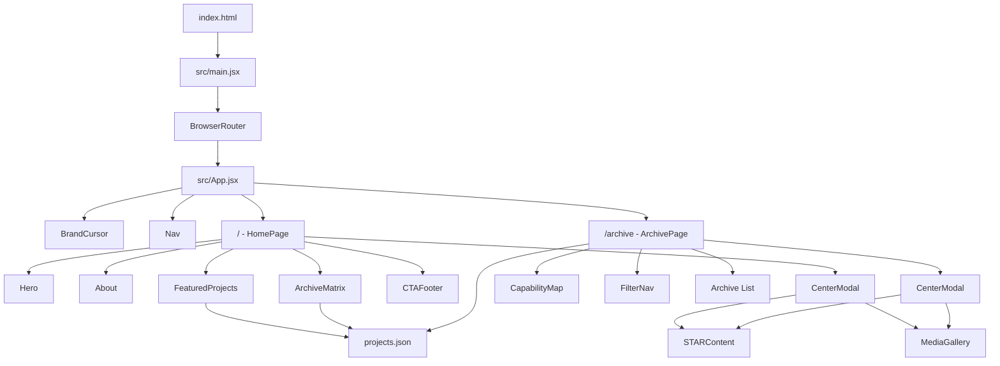
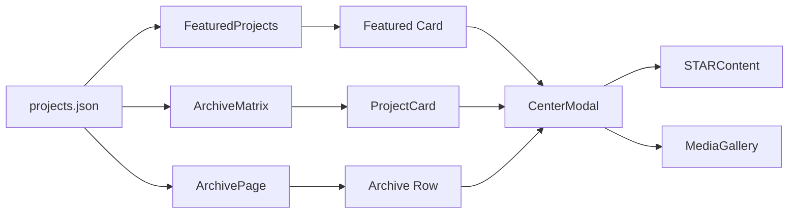
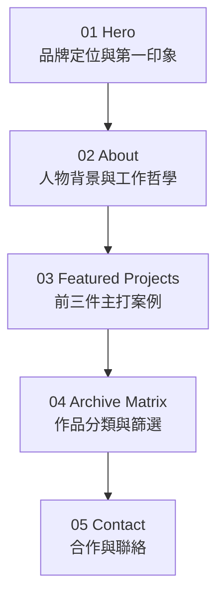

# 個人作品集網站架構說明

> Portfolio Website Architecture Guide  
> 本文件主要提供專案擁有者閱讀，以中文說明為主，並保留常用英文技術名稱，方便後續開發、維護與溝通。

---

## 1. 專案總覽 Project Overview

這是一個以 **React 18 + Vite** 建立的個人作品集網站，品牌核心為：

> **述說者 × 實踐家**  
> **The Storyteller × The Executor**

網站不是單純陳列成品，而是要向招募主管、面試官與潛在合作客戶呈現個人的綜合能力：

- 策略 Strategy
- 創意 Creativity
- 執行力 Execution
- 跨領域整合 Cross-disciplinary Integration
- 複雜資訊整理 Information Architecture
- 專案敘事 Project Storytelling

核心目標是讓閱讀時間有限的訪客，能快速理解：

1. 你是誰。
2. 你擅長什麼。
3. 你如何處理問題。
4. 你做過哪些作品。
5. 如何與你聯絡或合作。

---

## 2. 技術組成 Technology Stack

| 技術 | 用途 |
|---|---|
| React 18 | 建立頁面元件與管理互動狀態 |
| React DOM | 將 React 應用掛載到瀏覽器 DOM |
| React Router DOM | 管理首頁與 Archive 頁面的路由 |
| Framer Motion | Modal、卡片與介面轉場動畫 |
| Vite | 本機開發、模組載入與正式建置 |
| CSS | 全站視覺、響應式版面、動畫與主題 |
| JSON | 集中保存作品內容與分類資料 |
| FormSubmit | 接收聯絡表單並轉寄至 Email |

目前沒有後端伺服器或資料庫。作品內容直接由前端的 `projects.json` 提供。

---

## 3. 完整檔案架構 File Structure

### 3.1 純檔案架構
```text
Portfolio proposal/
├─ index.html
├─ package.json
├─ package-lock.json
├─ vite.config.js
├─ 修改.md
├─ 架構說明.md
│
├─ src/
│  ├─ main.jsx
│  ├─ App.jsx
│  ├─ index.css
│  │
│  ├─ pages/
│  │  ├─ HomePage.jsx
│  │  └─ ArchivePage.jsx
│  │
│  ├─ components/
│  │  ├─ About.jsx
│  │  ├─ ArchiveMatrix.jsx
│  │  ├─ BrandCursor.jsx
│  │  ├─ CapabilityMap.jsx
│  │  ├─ CenterModal.jsx
│  │  ├─ CTAFooter.jsx
│  │  ├─ FeaturedProjects.jsx
│  │  ├─ FilterNav.jsx
│  │  ├─ Hero.jsx
│  │  ├─ MediaGallery.jsx
│  │  ├─ Nav.jsx
│  │  ├─ ProjectCard.jsx
│  │  ├─ ProjectDetailSection.jsx
│  │  ├─ ProjectEvidence.jsx
│  │  ├─ SideDrawer.jsx
│  │  └─ STARContent.jsx
│  │
│  ├─ data/
│  │  └─ projects.json
│  │
│  └─ hooks/
│     ├─ useReveal.js
│     └─ useTheme.js
│
├─ public/
├─ dist/
│  ├─ index.html
│  └─ assets/
│
├─ UVF/
│  ├─ index_UV.html
│  ├─ portfolio.html
│  ├─ Portfolio (Standalone).html
│  ├─ zhen 個人作品集 (Standalone)0530.html
│  ├─ portfolio-proposal.md
│  ├─ portfolio-proposal.docx
│  ├─ portfolio-proposal (1).docx
│  ├─ portfolio_ia_diagram.svg
│  └─ portfolio_tech_architecture.svg
│
├─ node_modules/
└─ .claude/
   └─ settings.local.json
```
### 3.2 檔案架構圖及中文說明

Portfolio proposal/
├─ index.html                 # 瀏覽器 HTML 入口、字型與初始主題
├─ package.json               # 套件與 npm 指令
├─ package-lock.json          # 固定套件版本
├─ vite.config.js             # Vite + React 設定
├─ 修改.md                    # 修改紀錄、待辦與互動設計構想
│
├─ src/                       # 正式網站原始碼
│  ├─ main.jsx                # React 啟動點
│  ├─ App.jsx                 # 全域元件與路由
│  ├─ index.css               # 全站視覺、RWD、動畫與主題
│  │
│  ├─ pages/
│  │  ├─ HomePage.jsx         # 首頁區塊組裝
│  │  └─ ArchivePage.jsx      # 完整作品庫頁面
│  │
│  ├─ components/
│  │  ├─ Nav.jsx              # 導覽列、手機選單、主題切換
│  │  ├─ BrandCursor.jsx      # 品牌準心游標
│  │  ├─ Hero.jsx             # 首屏品牌主視覺
│  │  ├─ About.jsx            # 個人介紹
│  │  ├─ FeaturedProjects.jsx # 精選作品
│  │  ├─ ArchiveMatrix.jsx    # 首頁作品矩陣
│  │  ├─ CapabilityMap.jsx    # Archive 能力星圖
│  │  ├─ FilterNav.jsx        # 分類與年份篩選器
│  │  ├─ ProjectCard.jsx      # 共用作品卡片
│  │  ├─ ProjectEvidence.jsx  # Role / Constraint / Impact
│  │  ├─ CenterModal.jsx      # 現役作品詳情 Modal
│  │  ├─ STARContent.jsx      # STAR 專案敘事
│  │  ├─ MediaGallery.jsx     # 圖片／影片畫廊
│  │  ├─ CTAFooter.jsx        # 聯絡方式、表單與頁尾
│  │  ├─ ProjectDetailSection.jsx # 未使用的頁內展開方案
│  │  └─ SideDrawer.jsx       # 未使用的側邊抽屜方案
│  │
│  ├─ hooks/
│  │  ├─ useReveal.js         # 滾動揭露動畫
│  │  └─ useTheme.js          # 深色／亮色模式
│  │
│  └─ data/
│     └─ projects.json        # 所有作品資料來源
│
├─ public/                    # 公開靜態資源，目前為空
├─ dist/                      # npm run build 產生的部署檔案
├─ UVF/                       # 早期原型、企劃與架構參考
├─ node_modules/              # 第三方套件，不直接維護
└─ .claude/
   └─ settings.local.json     # 本機工具權限設定


### 3.3 目錄分工

| 目錄 | 主要功能 |
|---|---|
| `src/` | 正式網站的 React 原始碼 |
| `src/pages/` | 路由所對應的完整頁面 |
| `src/components/` | 可重複使用或各自負責特定區塊的元件 |
| `src/data/` | 作品內容與 metadata |
| `src/hooks/` | 共用 React 行為與狀態邏輯 |
| `public/` | 不經 Vite 處理、直接公開的靜態資源 |
| `dist/` | `npm run build` 產生的正式部署版本 |
| `UVF/` | 企劃書、早期 HTML 原型與歷史架構圖 |
| `node_modules/` | npm 安裝的第三方套件 |
| `.claude/` | 本機開發工具設定，不屬於網站功能 |

---

## 4. 網站啟動與路由流程 Application Flow



### 4.1 啟動順序

1. 瀏覽器讀取 `index.html`。
2. `index.html` 建立 `<div id="root">`。
3. `src/main.jsx` 將 React 應用掛載到 `#root`。
4. `BrowserRouter` 啟用前端路由。
5. `App.jsx` 載入全站共用的 `Nav` 與 `BrandCursor`。
6. React Router 根據網址顯示 `HomePage` 或 `ArchivePage`。

### 4.2 網站路由

| URL | 顯示頁面 | 用途 |
|---|---|---|
| `/` | `HomePage.jsx` | 品牌首頁、個人介紹、精選作品與聯絡 |
| `/archive` | `ArchivePage.jsx` | 完整作品庫、能力星圖、篩選與排序 |
| `/#project-{slug}` | 首頁 + Modal | 指向首頁中的特定作品 |
| `/archive#project-{slug}` | Archive + Modal | 指向作品庫中的特定作品 |

---

## 5. 根目錄檔案 Root Files

### 5.1 `index.html`

瀏覽器最先載入的 HTML 入口。

主要內容：

- 宣告頁面語言為繁體中文 `zh-Hant`。
- 設定 viewport，支援行動裝置。
- 設定網站標題「述說者 ✕ 實踐家 — 個人作品集」。
- 載入 Google Fonts。
- 建立 React 掛載點 `#root`。
- 載入 `/src/main.jsx`。
- 在 React 載入前讀取 `localStorage` 的主題設定。

提前設定主題的目的，是減少重新整理時先亮後暗或先暗後亮的畫面閃爍。

### 5.2 `package.json`

專案套件與指令設定。

常用指令：

```bash
npm run dev
npm run build
npm run preview
```

| 指令 | 功能 |
|---|---|
| `npm run dev` | 啟動 Vite 本機開發伺服器 |
| `npm run build` | 建立正式部署版本至 `dist/` |
| `npm run preview` | 在本機預覽 `dist/` 建置結果 |

### 5.3 `package-lock.json`

記錄直接與間接套件的精確版本，確保不同電腦執行 `npm install` 時得到一致結果。

這個檔案通常不手動編輯。

### 5.4 `vite.config.js`

Vite 設定檔，目前主要作用是啟用 React Plugin：

```js
plugins: [react()]
```

### 5.5 `修改.md`

開發歷史與需求紀錄，包含：

- 導覽列跨頁跳轉修正。
- 深色與亮色模式圖示。
- Gallery 畫廊需求。
- 作品證據 Role / Constraint / Impact。
- 品牌座標游標。
- Archive 能力星圖。
- STAR 敘事進度軌道構想。

這個檔案不會被網站執行，但可視為開發備忘錄與需求變更紀錄。

---

## 6. 應用入口 Application Entry

### 6.1 `src/main.jsx`

React 的正式啟動點。

主要工作：

- 載入 React 與 React DOM。
- 載入 `BrowserRouter`。
- 載入 `App.jsx`。
- 載入全域 `index.css`。
- 將網站掛載到 `document.getElementById('root')`。
- 使用 `React.StrictMode` 協助開發期間發現副作用問題。

### 6.2 `src/App.jsx`

網站最上層元件。

全站共用元件：

- `BrandCursor`
- `Nav`

路由設定：

```text
/         → HomePage
/archive  → ArchivePage
```

這表示導覽列與品牌游標不需要在每個頁面重複加入。

---

## 7. 頁面層 Pages

### 7.1 `src/pages/HomePage.jsx`

首頁的組裝與作品 Modal 狀態管理。

頁面順序：

```text
Hero
↓
About
↓
Featured Projects
↓
Archive Matrix
↓
CTA / Contact
↓
Center Modal（開啟時覆蓋畫面）
```

主要功能：

- 管理目前開啟的作品 `activeProject`。
- 讀取 `#project-{slug}`。
- 從 `projects.json` 找到對應作品。
- 點擊作品後更新 URL。
- 關閉作品後將 URL 還原為 `/`。

### 7.2 `src/pages/ArchivePage.jsx`

完整作品庫頁面。

主要狀態：

- `activeCategory`：目前選擇的能力分類。
- `activeYear`：目前選擇的年份。
- `sortKey`：排序方式。
- `activeProject`：目前開啟的作品。

支援的排序方式：

- 年份新到舊 Newest
- 年份舊到新 Oldest
- Score 高到低

頁面區塊：

1. Archive 標題。
2. Capability Map 能力星圖。
3. 分類與年份 Filter。
4. 排序按鈕。
5. 完整作品列表。
6. 頁尾。
7. Center Modal。

篩選能力時，程式使用 `metadata.capabilities`，而不是只使用作品的單一主分類 `category`。因此一個作品可以同時出現在多個能力篩選結果中。

---

## 8. 共用元件 Components

### 8.1 `Nav.jsx`

全站固定導覽列。

主要功能：

- 品牌名稱按鈕回到首頁頂端。
- About、Works、Contact 區塊跳轉。
- 從 `/archive` 返回首頁後再捲動至指定區塊。
- 桌面導覽與手機全螢幕選單。
- Escape 關閉手機選單。
- 視窗放大時自動關閉手機選單。
- 深色／亮色模式切換。
- Framer Motion 捲動進度條。

### 8.2 `BrandCursor.jsx`

桌面版品牌座標游標。

顯示條件：

- 裝置支援精細游標。
- 裝置支援 hover。
- 使用者沒有開啟 Reduced Motion。

互動功能：

- 一般狀態顯示 X 形準心。
- 移到可互動元素時轉為十字。
- 顯示元素的 `data-cursor-label`。
- 靠近右側或下側時自動改變標籤方向。
- 按下滑鼠時縮小準心。
- 使用 requestAnimationFrame 平滑跟隨位置。

### 8.3 `Hero.jsx`

首頁第一屏品牌主視覺。

主要區塊：

- Portfolio 年份標籤。
- Story × Execution 雙層文字。
- Story 與 Execution 的 hover／focus 揭露效果。
- 「說故事的腦。做實事的手。」打字動畫。
- 品牌價值說明。
- 看作品 CTA。
- 聯絡 CTA。
- 個人形象照佔位。
- 2026 年份視覺。
- Available 狀態。
- 跑馬燈 Marquee。

### 8.4 `About.jsx`

個人介紹區。

主要區塊：

- 關於我標題。
- 「策略 × 創意 × 執行力」主張。
- 個人所在城市。
- 工作起始年份。
- 語言能力。
- 目前接案狀態。
- 個人形象照。
- 個人引言與工作哲學。
- 技能標籤。

目前仍包含多個 `[待填入]` 欄位，正式上線前需要補齊。

元件內另有 Intersection Observer，負責區塊進入視窗時的 reveal 動畫。

### 8.5 `FeaturedProjects.jsx`

首頁精選作品區。

資料處理流程：

1. 從 `projects.json` 讀取所有作品。
2. 篩選 `metadata.is_featured === true`。
3. 依 `featured_score.total` 由高至低排序。
4. 取前三件作品。

每張卡片包含：

- 縮圖。
- 能力分類。
- 標題。
- Hook。
- Role / Constraint / Impact。
- 年份。
- 開啟作品箭頭。

### 8.6 `ArchiveMatrix.jsx`

首頁中的作品總覽矩陣。

主要功能：

- 依能力篩選。
- 依年份篩選。
- 顯示完整作品卡片網格。
- 使用 `ProjectCard`。
- 高亮目前正在 Modal 中查看的作品。
- 使用 Intersection Observer 執行 reveal 動畫。

### 8.7 `CapabilityMap.jsx`

Archive 頁面的互動能力星圖。

四個主要能力：

- Architect
- Maker
- Lens
- Writer

互動方式：

- 點擊能力節點，篩選具備該能力的作品。
- 點擊作品原點，反向高亮該作品具備的能力。
- 點擊中央 All，清除能力篩選。
- 點擊背景，清除目前選擇的作品。
- 手機版改用按鈕列表，避免 SVG 操作困難。

### 8.8 `FilterNav.jsx`

共用篩選工具列。

包含：

- All
- Architect
- Maker
- Lens
- Writer
- 由作品資料動態產生的年份

再次點擊已選年份時會取消該年份篩選。

### 8.9 `ProjectCard.jsx`

Archive Matrix 使用的共用作品卡片。

功能與精選作品卡片相似，但接受以下 props：

- `project`
- `isActive`
- `onClick`

支援滑鼠點擊及 Enter／Space 鍵盤操作。

### 8.10 `ProjectEvidence.jsx`

作品卡片中的關鍵證據區。

固定顯示：

| 欄位 | 意義 |
|---|---|
| Role | 你在專案中的角色 |
| Constraint | 專案限制或挑戰 |
| Impact | 實際完成的影響或成果 |

這個區塊的目的，是讓作品不只呈現名稱和圖片，也快速回答「你負責什麼、困難是什麼、最後完成什麼」。

### 8.11 `CenterModal.jsx`

目前正式使用中的作品詳情視窗。

主要功能：

- 使用 Framer Motion 淡入背景。
- 使用 spring animation 顯示 Modal。
- 點擊背景關閉。
- 按 Escape 關閉。
- 開啟時鎖定背景頁面捲動。
- 顯示標題、分類、年份與 Tags。
- 組合 `STARContent` 與 `MediaGallery`。

首頁與 Archive 頁都共用這個元件。

### 8.12 `STARContent.jsx`

將作品內容整理成 STAR 敘事：

| 字母 | 英文 | 中文意義 |
|---|---|---|
| S | Situation | 專案背景與情境 |
| T | Task | 需要完成的核心任務 |
| A | Action | 實際採取的行動 |
| R | Result | 最終成果與影響 |

在 STAR 之前先顯示 `hook`，作為專案的一句話重點。

### 8.13 `MediaGallery.jsx`

作品詳情中的媒體畫廊。

支援：

- 圖片。
- 影片。
- 上一個／下一個媒體。
- 目前媒體數量。
- 縮圖切換。
- 媒體資料更新時回到第一張。

當 `media` 為空時，會顯示：

- 主畫面佔位。
- 停用的左右箭頭。
- `00 / 00`。
- 四個縮圖佔位框。

### 8.14 `CTAFooter.jsx`

首頁底部聯絡與行動呼籲區。

主要內容：

- 地點 Taipei, Taiwan。
- Availability。
- Email。
- LinkedIn。
- Instagram。
- 聯絡表單。
- Copyright。
- 前往完整 Archive 的連結。

聯絡表單欄位：

- 姓名 Name
- 電子郵件 Email
- 訊息 Message

送出方式：

```text
使用者填寫表單
→ fetch POST
→ formsubmit.co
→ 轉寄至指定 Gmail
→ 顯示成功或失敗訊息
```

### 8.15 `ProjectDetailSection.jsx`

頁面內嵌式作品詳情方案。

原本企劃是把詳情插入 Archive Matrix 與 CTA 之間，讓內容把後方區塊向下推。

目前沒有被任何頁面引用，屬於保留方案或舊版元件。

### 8.16 `SideDrawer.jsx`

右側滑入式作品詳情方案。

具備：

- 背景遮罩。
- 右側 spring 滑入。
- Escape 關閉。
- 鎖定背景捲動。
- STAR 與 Gallery。

目前沒有被任何頁面引用，屬於備案。

---

## 9. Hooks

### 9.1 `useReveal.js`

共用捲動揭露動畫 Hook。

使用 Intersection Observer 觀察：

- `.reveal`
- `.stagger`

元素進入畫面後加入 `.is-in`，再由 CSS 執行透明度與位移動畫。

### 9.2 `useTheme.js`

深色／亮色模式 Hook。

主題取得優先順序：

1. `localStorage` 中的 `portfolio-theme`。
2. 作業系統 `prefers-color-scheme`。
3. 設定至 `<html data-theme="...">`。

切換後會：

- 更新 React state。
- 更新 `data-theme`。
- 儲存至 `localStorage`。

---

## 10. 作品資料 `projects.json`

這是網站作品內容的單一資料來源 Single Source of Truth。

目前共有五件作品：

1. 《夏日進行中》情緒敘事攝影集
2. 《手作女子聚會》活動策劃與執行
3. 榮耀基金會實習 — 臺灣音樂劇統計專案統籌
4. 《詭哭郎嚎》排練助理 ＆ 小道具
5. 《老闆，來碗陽春麵！》排練助理 ＆ 小道具

### 10.1 資料結構

```text
project
├─ id
├─ title
├─ slug
├─ year
├─ category
├─ tags[]
├─ thumbnail
├─ media[]
├─ evidence
│  ├─ role
│  ├─ constraint
│  └─ impact
├─ narrative
│  ├─ hook
│  ├─ situation
│  ├─ task
│  ├─ action
│  └─ result
└─ metadata
   ├─ is_featured
   ├─ featured_score
   │  ├─ commercial
   │  ├─ skill_range
   │  ├─ narrative
   │  └─ total
   ├─ tools[]
   ├─ capabilities[]
   ├─ relevant_roles[]
   ├─ target_roles[]
   ├─ keywords[]
   └─ show_in_archive_only
```

### 10.2 重要欄位差異

`category` 是作品唯一的主分類。

`metadata.capabilities` 可以有多個值，表示作品實際展現的所有能力。

例如：

```json
{
  "category": "Architect",
  "capabilities": ["Architect", "Writer"]
}
```

代表作品的主要角色是 Architect，但同時展現 Writer 能力。

### 10.3 資料流



---

## 11. 全站樣式 `src/index.css`

`index.css` 約 1,500 行，目前集中管理全部元件樣式。

### 11.1 CSS 區塊

| 大約位置 | 區塊 |
|---|---|
| 開頭 | Design Tokens |
| 24 行附近 | Reset & Base |
| 44 行附近 | Brand Cursor |
| 161 行附近 | Scrollbar |
| 186 行附近 | Utilities |
| 201 行附近 | Section Chrome |
| 221 行附近 | Buttons |
| 241 行附近 | Marquee |
| 254 行附近 | Toast |
| 267 行附近 | Nav |
| 340 行附近 | Hero |
| 552 行附近 | About |
| 599 行附近 | Featured Projects |
| 667 行附近 | Project Evidence |
| 759 行附近 | Archive Matrix |
| 771 行附近 | Filter Nav |
| 794 行附近 | Project Grid |
| 834 行附近 | Project Detail Section |
| 868 行附近 | STAR |
| 877 行附近 | Media Gallery |
| 922 行附近 | Side Drawer |
| 967 行附近 | Center Modal |
| 1035 行附近 | CTA Footer |
| 1054 行附近 | Contact Form |
| 1099 行附近 | Site Footer |
| 1111 行附近 | Archive Page |
| 1115 行附近 | Capability Map |
| 1368 行附近 | Archive Filter & Sort |
| 1401 行附近 | Theme Toggle |
| 1439 行附近 | Light Theme Overrides |

### 11.2 Design Tokens

重要全域變數：

```css
--bg
--fg
--muted
--line
--line-2
--accent
--modal-bg
--modal-fg
--display
--body
--mono
--pad-x
```

若要調整全站配色、字型或左右留白，應先從這裡修改。

### 11.3 響應式設計 Responsive Design

主要 breakpoint：

```text
1024px  平板與小型桌面
768px   平板／大型手機
480px   一般手機
```

### 11.4 無障礙與動態偏好

CSS 有處理：

```css
@media (prefers-reduced-motion: reduce)
```

當使用者偏好降低動態時：

- 大部分動畫時間縮短。
- Reveal 元素直接顯示。
- 跑馬燈停止。
- 品牌游標隱藏。

---

## 12. 首頁資訊架構 Information Architecture



各區塊的敘事目的：

| 區塊 | 回答的問題 |
|---|---|
| Hero | 你是怎樣的人？ |
| About | 你如何思考與工作？ |
| Featured Projects | 你最值得先看的作品是什麼？ |
| Archive Matrix | 你還做過哪些事？ |
| Contact | 下一步如何聯絡你？ |

---

## 13. 主要服務與能力分類 Services & Capabilities

### 13.1 Architect｜策劃與系統設計

核心角色：定義問題、設計框架、規劃全局的人。

涵蓋內容：

- 活動企劃
- 專案管理
- 研究統籌
- 資訊架構
- 流程設計
- 跨部門協調

### 13.2 Maker｜製作與視覺實現

核心角色：把概念轉為實際產出物的人。

涵蓋內容：

- 視覺設計
- 原型製作
- 平面輸出
- 道具製作與管理
- 現場執行

### 13.3 Lens｜攝影與影像敘事

核心角色：透過鏡頭捕捉並重新詮釋現實的人。

涵蓋內容：

- 攝影集
- 個人寫真
- 演出紀錄
- 情緒敘事
- 影像後製
- 視覺風格建立

### 13.4 Writer｜文字與品牌敘事

核心角色：賦予資訊意義、語言與故事的人。

涵蓋內容：

- 專案敘事
- 文案企劃
- 品牌內容
- 研究整理
- 世界觀與故事設計

---

## 14. `public/`、`dist/` 與 `node_modules/`

### 14.1 `public/`

目前沒有正式資源。

未來適合放置：

- 個人形象照。
- 作品縮圖。
- 作品 Gallery 圖片與影片。
- PDF 履歷。
- Favicon。
- Open Graph 分享圖片。

放在 `public/` 的檔案，可以使用根路徑引用：

```text
/images/profile.jpg
/resume.pdf
```

### 14.2 `dist/`

執行以下指令後產生：

```bash
npm run build
```

內容包括：

- 建置後的 `index.html`。
- 壓縮與加上 hash 的 JavaScript。
- 壓縮與加上 hash 的 CSS。

`dist/` 是部署結果，不應直接手動修改。原始碼改動後應重新執行 build。

### 14.3 `node_modules/`

包含 React、Vite、Framer Motion 等第三方套件。

注意事項：

- 不直接手動修改。
- 通常不提交至 Git。
- 若刪除，可透過 `npm install` 重新建立。

---

## 15. `UVF/` 歷史與企劃資料

`UVF/` 不屬於目前 React 網站的執行程式，但保留了重要設計來源。

### 15.1 `portfolio-proposal.md`

完整企劃書，包含：

- 專案目的。
- 目標受眾。
- 品牌定位。
- Hero 文案。
- 頁面資訊架構。
- 四大能力分類。
- 作品 Modal 規格。
- About 區塊規範。
- RWD 與視覺規範。

### 15.2 DOCX 企劃書

- `portfolio-proposal.docx`
- `portfolio-proposal (1).docx`

為企劃書的 Word 版本。

### 15.3 HTML 原型

- `portfolio.html`
- `index_UV.html`

屬於早期單檔 HTML/CSS/JavaScript 原型，是目前 React 版本的設計參考來源。

### 15.4 Standalone HTML

- `Portfolio (Standalone).html`
- `zhen 個人作品集 (Standalone)0530.html`

將圖片、字型或其他資源大量嵌入單一 HTML，因此檔案較大，可獨立開啟。

### 15.5 SVG 架構圖

- `portfolio_ia_diagram.svg`：資訊架構圖。
- `portfolio_tech_architecture.svg`：技術架構圖。

---

## 16. 現役、備案與歷史元件

### 16.1 目前正式使用

- `Nav.jsx`
- `BrandCursor.jsx`
- `Hero.jsx`
- `About.jsx`
- `FeaturedProjects.jsx`
- `ArchiveMatrix.jsx`
- `CapabilityMap.jsx`
- `FilterNav.jsx`
- `ProjectCard.jsx`
- `ProjectEvidence.jsx`
- `CenterModal.jsx`
- `STARContent.jsx`
- `MediaGallery.jsx`
- `CTAFooter.jsx`

### 16.2 已存在但目前未使用

- `ProjectDetailSection.jsx`
- `SideDrawer.jsx`

這兩個元件提供不同的作品詳情呈現方案，但目前實際使用的是 `CenterModal.jsx`。

後續可以選擇：

1. 保留並移至 `legacy/` 或 `experiments/`。
2. 加上註解說明用途。
3. 確認不再需要後刪除，減少維護成本。

---

## 17. 目前待完成內容

### 17.1 About

- 城市名稱。
- 工作起始年份。
- 語言與程度。
- 目前狀態。
- 個人形象照。
- 正式個人引言。
- 工作哲學與能力宣言。
- 正式技能標籤。

### 17.2 Projects

- 各作品 Hook。
- Situation。
- Task。
- Action。
- Result。
- 正式縮圖。
- Gallery 圖片或影片。
- 使用工具。
- 更明確的成果與影響。

### 17.3 Contact

- 正式 LinkedIn URL。
- 確認 Email 是否為正式收件地址。
- 確認 FormSubmit 首次驗證。
- 視需要加入 PDF 履歷下載。

### 17.4 Branding

- Favicon。
- SEO description。
- Open Graph 分享圖片。
- 正式網站網址。
- 正式創作者姓名。

---

## 18. 目前風險與維護提醒

### 18.1 BrowserRouter 部署設定

網站使用 `BrowserRouter`。部署平台必須將未知路徑回退至 `index.html`。

否則直接開啟：

```text
https://example.com/archive
```

可能會由伺服器回傳 404。

### 18.2 外部字型

Google Fonts 需要網路連線。若載入失敗，會改用備用字型。

正式上線若重視速度與隱私，可評估將字型改為 self-hosted。

### 18.3 聯絡表單

表單依賴第三方 `formsubmit.co`：

- 網路中斷時無法送出。
- 第一次使用可能需要 Email 驗證。
- 前端公開收件 Email。
- 可能受到第三方服務政策變更影響。

### 18.4 CSS 規模

全部樣式集中在一個約 1,500 行的檔案。

目前尚可運作，但後續增加內容時可考慮拆為：

```text
styles/
├─ tokens.css
├─ base.css
├─ nav.css
├─ hero.css
├─ projects.css
├─ archive.css
├─ modal.css
├─ contact.css
└─ themes.css
```

### 18.5 重複的 Intersection Observer

專案已有 `useReveal.js`，但 About、FeaturedProjects、ArchiveMatrix、CTAFooter 仍各自建立 Intersection Observer。

後續可以逐步統一使用 `useReveal`，減少重複邏輯。

### 18.6 URL 與瀏覽器歷史

部分作品 URL 使用原生：

```js
window.history.pushState(...)
```

目前可以更新網址，但瀏覽器上一頁／下一頁時，元件狀態未必會完全同步。後續可改由 React Router 的 location 與 navigation 統一管理。

### 18.7 測試與程式品質工具

目前尚未看到：

- 單元測試 Unit Tests。
- 元件測試 Component Tests。
- E2E Tests。
- ESLint。
- Prettier。

若網站內容持續擴充，可優先加入 ESLint，再為篩選、排序、Modal 與表單加入測試。

---

## 19. 建議維護流程 Recommended Workflow

### 修改作品內容

優先修改：

```text
src/data/projects.json
```

### 修改頁面文字

依區塊找到對應元件：

```text
Hero       → Hero.jsx
About      → About.jsx
精選作品    → FeaturedProjects.jsx
作品總覽    → ArchiveMatrix.jsx
Archive    → ArchivePage.jsx
聯絡資訊    → CTAFooter.jsx
```

### 修改視覺

修改：

```text
src/index.css
```

建議先搜尋元件使用的 `className`，再調整對應 CSS。

### 新增作品

1. 在 `projects.json` 的 `projects` 陣列新增一筆資料。
2. 確保 `id` 與 `slug` 不重複。
3. 設定主分類 `category`。
4. 設定多能力 `metadata.capabilities`。
5. 填入 Evidence 與 STAR。
6. 加入 thumbnail 和 media。
7. 視需要設定 `is_featured`。

### 正式建置

```bash
npm run build
```

建置後檢查：

- 首頁。
- `/archive`。
- 深色／亮色模式。
- 桌面與手機導覽。
- 分類與年份篩選。
- Score 排序。
- 作品 Modal。
- Gallery。
- 聯絡表單。
- 直接開啟 `/archive` 是否正常。

---

## 20. 一句話理解整個專案

```text
projects.json 提供作品內容
→ Pages 決定完整頁面
→ Components 組成畫面與互動
→ Hooks 提供共用行為
→ index.css 控制整體視覺
→ Vite 將原始碼建置成 dist 部署檔案
```

這個專案的核心不是「很多獨立頁面」，而是：

> 以首頁單頁敘事建立品牌印象，再透過 Archive、能力篩選與作品 Modal 提供深入探索。

---

## 21. 文件更新原則

若未來發生以下變更，建議同步更新本文件：

- 新增或刪除頁面。
- 新增路由。
- 更換作品詳情呈現方案。
- 調整 `projects.json` 結構。
- 新增後端或 CMS。
- 拆分 CSS。
- 更換聯絡表單服務。
- 新增正式部署平台。
- 移除歷史或備案元件。

最後更新日期：2026-06-10
